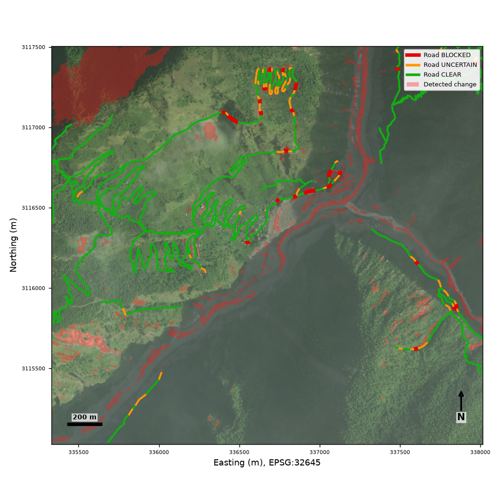

# MAPPA-Neo — The First Map After The Landslide

**Offline-first rapid disaster mapping platform** turning consumer drone or post-event aerial imagery into a **georeferenced change map**, **blocked-road assessment**, **Neo4j safe detour & PWD excavator clearance priority queue**, and **QGIS-ready exports + one-page PDF brief** — running on an ordinary laptop with no ground control points and honest positional accuracy reporting.
live deployed link - https://mappa-neo.onrender.com/

> Problem Statement: *"The First Map After The Landslide"*  
> Validated on **REAL 26 August 2026 Nepal Bhote Koshi / Trishuli Flash Flood** imagery (`Syabrubesi, Rasuwa District` · Copernicus EMS Activation `EMSR927`) + our controlled synthetic DSM−DEM benchmark.



---

## What Makes MAPPA-Neo Different

```
 Post-event drone/aerial ortho (+ optional DSM)
 Pre-cached base imagery (+ Copernicus DEM + OSM roads)
                        │
   ┌────────────────────▼────────────────────────────────────┐
   │ 1. Memory-Safe Metric Grid & SIFT+RANSAC / Phase Reg    │ → GCP-free georef + honest ±X m (95%) error budget
   │ 2. Radiometric Normalise + Colour & DSM−DEM Change Det  │ → Change mask + height anomaly (m)
   │ 3. 20–25 m Road Segment Scoring + Debris Volume (m³)    │ → BLOCKED / UNCERTAIN / CLEAR stretches
   │ 4. Neo4j Spatial Road-Connectivity Knowledge Graph      │ → Cypher safe detours + isolated villages + PWD priority queue
   │ 5. FastAPI + SQLite RBAC Web App + Standard GIS Exports │ → Interactive Leaflet UI + GeoTIFF/GPKG/GeoJSON/KML/CSV/PDF
   └─────────────────────────────────────────────────────────┘
```

### Real 2026 Nepal Flood Validation (Syabrubesi, Rasuwa — `EMSR927`)
- **Event:** 26 Aug 2026 Bhote Koshi / Trishuli flash flood & rock-ice debris flow.
- **Real Open Sources Used:** Post-flood VHR (`Vantor/Maxar 2026-09-06` via OpenAerialMap), Pre-flood VHR (`Vantor/Maxar 2021-10-16`), OpenStreetMap road network (39 ways, 1,316 segments), Copernicus GLO-30 DEM, and official **Copernicus EMS `EMSR927` photo-interpreted road grading** (21 graded segments in Syabrubesi AOI: 11 Destroyed, 5 Possibly damaged, 5 No visible damage).
- **Measured Offline Laptop Performance:** **6.65 km²** processed at **1.5 m/px** in **25.8 seconds** on CPU (no GPU, zero OOM).
- **Honest Validation vs. Copernicus EMS Ground Truth:**
  - `539.1 m` of Copernicus-confirmed damaged road flagged automatically (`36.7%` optical-only recall, `70.9%` clear agreement on undamaged roads).
  - **Scientific takeaway confirmed on real data:** Optical-only change detection on steep Himalayan terrain loses recall/precision from shadows and dirt-road colour similarity — directly validating our synthetic ablation finding (colour-only recall `0.00` vs. DSM−DEM height-cue recall `1.00`) and proving why flying a drone for a post-event **DSM** (`--dsm`) is mission-critical.

### Partner Technology Core Flow: **Neo4j** (`mappa/graph_neo4j.py`)
- Turns scored road segments into a spatial knowledge graph: `(:Mission)`, `(:Junction)`, `(:Facility {population_est})`, `[:ROAD_SEGMENT {status, length_m, est_debris_vol_m3}]`, `[:CONNECTED_TO]`.
- **Segment 1 (NDRF / SDRF Commanders):** Live Cypher shortest-path **Safe Detour Routing** avoiding `BLOCKED` (and optionally `UNCERTAIN`) road segments.
- **Segment 2 (PWD / BRO Highway Clearance Engineers):** Live Cypher **Isolation & Clearance Priority Queue** simulating edge restoration and corridor cut-set dependency to rank which blockage reconnects the highest isolated population per `m³` of debris first — with live **"Mark Cleared"** Neo4j graph mutation!
- **Offline-First Resilience:** Connects live over Bolt to **Neo4j AuraDB** (or local Neo4j) when `NEO4J_URI` is set or entered in the UI, and transparently falls back to an identical local NetworkX mirror when disconnected in the field.

---

## Quick Start (Runs Offline or Deployed Live)

```bash
pip install -r requirements.txt

# 1. Verify all 8 unit + API + RBAC + Neo4j + Real-Nepal tests
python -m pytest -p no:cacheprovider -v tests

# 2. Launch the evaluator-ready Web App (default: http://127.0.0.1:8000)
python -m mappa serve --host 127.0.0.1 --port 8000
```

**Evaluator Demo Credentials (also one-click inside the Sign-In modal):**
- **NDRF Incident Commander (Primary Segment):** `commander@mappa.org` / `MappaCmd#2026`
- **PWD / BRO Clearance Engineer (Segment 2):** `engineer@mappa.org` / `MappaPwd#2026`

### Connecting Live Neo4j AuraDB
Copy `.env.example` to `.env` and fill in your free **Neo4j AuraDB** `NEO4J_URI`, `NEO4J_USERNAME`, and `NEO4J_PASSWORD` — or click the **Neo4j Graph** pill in the top header while signed in to connect & sync all missions live.

### Re-Fetching Real 2026 Nepal Data (Optional, Online Once)
```bash
python scripts/fetch_nepal_2026.py
python scripts/run_nepal_2026.py
```


MIT Licensed. Nepal 2026 imagery via OpenAerialMap / Vantor / Copernicus EMS (`EMSR927`) / OpenStreetMap (ODbL).
