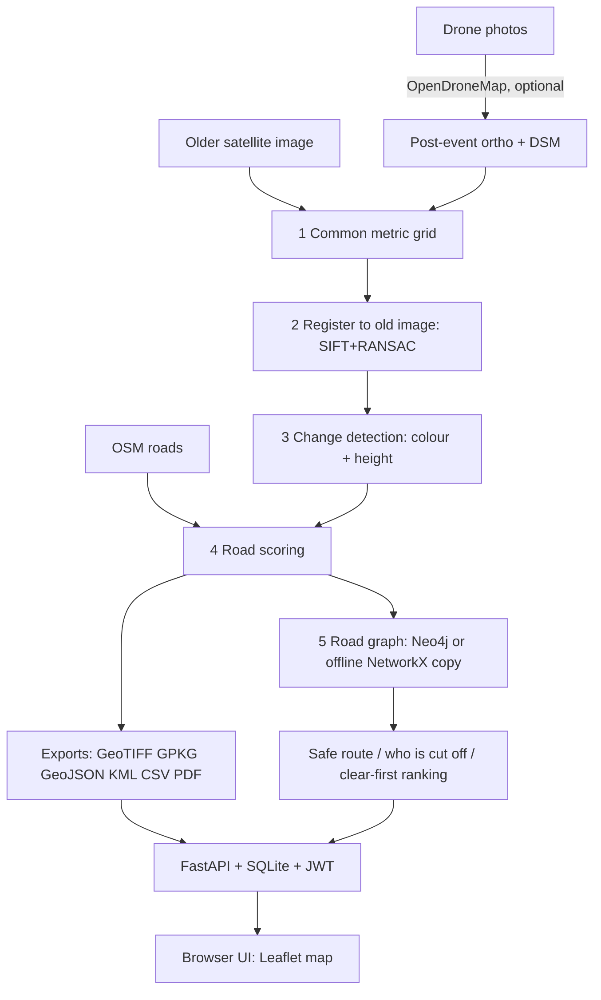

# MAPPA-Neo — Technical Architecture

## 1. One-paragraph summary
MAPPA turns **post-disaster aerial imagery + an older reference image + a road file** into (a) a georeferenced change map, (b) a per-road status (BLOCKED / MAYBE / OPEN), (c) a road-connectivity graph that answers "who is cut off, what is the safe route, what should be cleared first", and (d) agency-ready files. It runs on a laptop with no internet.

## 2. Which "model" compares the pictures? (honest answer)
**There is no AI / machine-learning / LLM model in the image comparison.** Everything is classical, deterministic computer vision and geometry, so results are explainable and reproducible, and nothing needs a GPU, a download, or the cloud.

| Step | Technique | Library |
|---|---|---|
| Find matching landmarks between new and old image | **SIFT** keypoints (hand-designed features, not learned) + Lowe ratio test | OpenCV |
| Remove wrong matches, estimate shift/rotation | **RANSAC** robust fit of a similarity transform (4 DOF) | OpenCV `estimateAffinePartial2D` |
| Fallback if too few landmarks | **FFT phase correlation** (translation only) | OpenCV |
| Remove season / lighting differences | **Quantile-matched linear radiometric normalisation** per colour band | NumPy |
| Decide what changed | Gaussian blur to the older image's resolution, **RGB distance**, threshold = median + k·MAD (robust), morphology, minimum-area filter | OpenCV / NumPy |
| Detect rubble on roads (when height data exists) | **DSM − DEM** (drone surface model minus Copernicus ground model), vertical bias removed | rasterio / NumPy |
| Judge each road | 20–25 m road pieces, buffered, share of buffer that changed + mean height anomaly | GeoPandas / Shapely |

(The assistant that helped write this code is a large language model, but **no LLM runs inside the product**.)

## 3. System architecture

### Components
| Layer | File | Role |
|---|---|---|
| Grid & IO | `mappa/grid.py` | One metric grid; auto-reduces resolution above 2400 px so laptops never run out of memory |
| Georeferencing | `mappa/georef.py` | SIFT+RANSAC, honest accuracy budget |
| Change | `mappa/change.py` | Normalise, difference, DSM−DEM |
| Roads | `mappa/roads.py` | Segment, score, classify, rubble-volume estimate, Copernicus comparison |
| Graph | `mappa/graph_neo4j.py` | Builds junction/road graph; Cypher queries; offline NetworkX mirror |
| API | `mappa/web_app.py` | REST endpoints, uploads, downloads |
| Auth & hardening | `mappa/security.py` | bcrypt, JWT cookie, RBAC, rate limits, CSP and other headers, path-traversal guard |
| Storage | `mappa/db.py` | SQLite: users, missions, work orders, audit log |
| UI | `mappa/static/*` | Plain-language, large-button Leaflet app |

## 4. Georeferencing without ground control points
1. The post-event image has only rough GPS position.
2. SIFT landmarks (roads, buildings, rivers) are matched to the older, already-georeferenced image.
3. RANSAC estimates the shift and rotation; the shift is applied to the file's georeference (pixels are not resampled).
4. **Stated accuracy = √(base_accuracy² + (2·registration RMS)²)**. Absolute accuracy is limited by the older image, not by our code. Default stated: ±10 m (95%), unverified on the ground.
5. If matching fails (e.g. very different images), the fallback is phase correlation and a conservative error bound. On the real Nepal data the fallback was used (0 SIFT inliers), and this is reported, not hidden.

## 5. Road status rules
- With height data: BLOCKED if ≥40 % of the buffer changed **and** mean height anomaly ≥0.5 m; MAYBE BLOCKED if ≥15 % changed.
- Without height data (photos only): BLOCKED needs ≥45–60 % changed (tunable). Weaker evidence, so more false alarms.
- Thresholds are **not field-calibrated**.

## 6. Road graph (Neo4j) — what it adds
- Nodes: `Mission`, `Junction`, `Facility` (village, clinic, bridge, start point with an estimated population).
- Edges: `ROAD_SEGMENT {status, length_m, est_debris_vol_m3, stretch_key}`, `CONNECTED_TO`.
- Queries (all parameterised Cypher): **isolation** (who cannot reach the start point without crossing a BLOCKED road), **safe detour** (shortest path avoiding blocked roads), **clearance ranking** (simulate clearing each blocked stretch, rank by people reconnected, corridor dependency and rubble volume), **status update** when a road crew marks a stretch cleared.
- Works against Neo4j AuraDB when credentials are set; otherwise an identical in-memory NetworkX graph answers, and the UI says which is active.
- Facility populations and the start point for the Nepal mission are **analyst estimates**, not census data.

## 7. Real-data validation (Nepal, 26 Aug 2026 Bhote Koshi/Trishuli flood, Syabrubesi)
- Post: Vantor/Maxar 2026-09-06; Pre: Vantor/Maxar 2021-10-16 (both via OpenAerialMap); roads: OpenStreetMap; reference: Copernicus EMS EMSR927 road grading (21 segments in the window: 11 destroyed, 5 possibly damaged, 5 no visible damage).
- 6.65 km² at 1.5 m/px in 25.8 s, CPU only.
- Against Copernicus: recall 36.7 %, precision 18.8 %, 70.9 % agreement on undamaged roads. **Photos alone are weak** on steep terrain (shadows, 5-year gap, dirt roads look like debris). On the synthetic scene, colour-only recall was 0 and colour + height gave 1.0, which is why the drone height model matters.

## 8. Security (for the ArgosX scan)
bcrypt password hashes; HS256 JWT in HttpOnly SameSite cookie; role checks on write endpoints; sliding-window rate limits; parameterised SQL and Cypher; allow-listed downloads with canonical-path check; upload type and size limits; CSP, X-Frame-Options, nosniff, Referrer-Policy, HSTS on HTTPS. Demo accounts exist for judging and **must be changed or removed for real use**.

## 9. Known limitations
- Not tested on a real drone flight; OpenDroneMap stitching time not measured.
- Only one real event; thresholds not tuned on more data.
- Populations and facilities are estimates. Road width for rubble volume is assumed 6 m.
- The older image must be reasonably recent and cloud-free.
